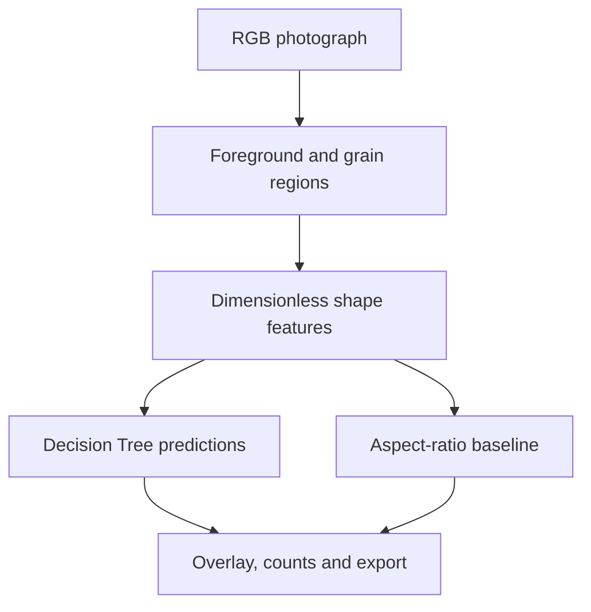

# BigasCheck — report draft

**Draft, not a final submission PDF.** Complete the related-work review, manual local evaluation, genuine team contributions and final references before export. This draft reports development evidence and does not certify rice grades.

## Abstract

BigasCheck examines photographs of rice grains to estimate visible grain integrity and broken-grain proportion by count. The prototype combines threshold-based segmentation, morphological cleanup, optional distance-transform watershed, and an interpretable Decision Tree. A public Peruvian rice dataset supplied whole and broken reference labels. After removing duplicate or conflicting files and screening unusable images, 3,877 grain images remained, divided into 2,713 training, 582 validation, and 582 development-test instances. The current classifier uses dimensionless silhouette features so that uniform image scaling and background color do not directly determine its inputs. On the reused development-test split, the classifier achieved 96.05% accuracy, macro-F1 of 0.9409, and broken-grain F1 of 0.9069. These figures describe isolated-grain classification, not independent multi-grain counting or segmentation accuracy. The application supports image upload, replacement previews, held-out sample selection, annotated results, and downloadable reports. Source capture groups and independent label checks remain unavailable, while crowded pale-background photographs produce substantial errors. Fresh local annotations and a previously unused capture-level evaluation set are therefore required before claiming reliable real-world rice-quality estimates.

## 1. Introduction and measurable objectives

Manual visual rice inspection is labor-intensive. This student prototype explores interpretable image processing for experimental grain counting and visible integrity estimation. Intended users are students and demonstrators using controlled photographs, not commercial graders.

The proposal targets broken-grain F1 ≥ 0.80, mean count error ≤ 5 grains, and mean broken-percentage error ≤ 5 percentage points. Only isolated source-grain classification has development evidence so far. The count and percentage targets have not been verified against independent local ground truth.

## 2. Related work — to complete

Review 3–5 genuinely referenced approaches or systems before final submission. Relevant comparisons include global thresholding, adaptive/pale-background segmentation, marker-controlled watershed, interpretable shape classifiers, and learned instance segmentation for crowded grains. Do not present package documentation alone as a completed research literature review. The proposal's rice-quality paper and Peruvian dataset repository are starting points, not verified evidence of local performance.

## 3. Dataset

See `DATA_CARD.md` for source, labels, image sizes, counts and exclusions. The current source split is 70/15/15 at image level, not verified capture level. Exact duplicates/conflicting files were excluded. Original label correctness and usage terms still need independent confirmation.

The test gallery contains 582 development-test images and three six-grain composites using only those images. Composites are demonstrations, not independent captured photographs. Because the test images have been exposed during development, final evaluation must use a fresh capture-level set.

## 4. Methodology

The same `vision.py` and `model.py` functions support training, command-line analysis and the Flask application. Image loading applies EXIF orientation and RGB conversion. Segmentation uses grayscale Otsu on dark surfaces, or three-class foreground thresholding plus local contrast on pale surfaces. Morphology removes noise; small-hole filling avoids filling visible table areas enclosed by rice. Optional watershed separates connected regions, while nearly convex regions are preserved to reduce over-splitting.

The Decision Tree uses aspect ratio, solidity, and area/(major-axis × minor-axis). The baseline thresholds aspect ratio. Parameters were selected using validation F1, with seed 42. The saved shape tree has depth 5 and minimum leaf size 10. Inputs and outputs are in pixel units; no millimeter calibration exists.

## 5. Experimental setup

Commands: `python src/evaluate.py --split validation --output outputs/checkpoints/validation` and the same command with `--split test` for the reused development-test split. Classification metrics use the reproducible extracted feature table. Runtime independently executes image loading, segmentation, features and classification on 20 CPU images after three warm-ups, with weights loaded once. Rendering, output writing and browser transport are excluded from that timing. Hardware, Python/dependency versions and weight/data hashes are saved in `metrics.json`.

The serialized model is 7,176 bytes in this measured version. The UI also records per-image core processing time and a tree leaf-vote score. A leaf vote is not calibrated confidence that a prediction is correct.

## 6. Results so far

| Split / method | Accuracy | Macro-F1 | Broken F1 |
|---|---:|---:|---:|
| Validation baseline | 0.9725 | 0.9580 | 0.9333 |
| Validation Decision Tree | 0.9588 | 0.9389 | 0.9040 |
| Development-test baseline | 0.9588 | 0.9362 | 0.8983 |
| Development-test Decision Tree | 0.9605 | 0.9409 | 0.9069 |

The baseline is stronger on this validation split. The tree's small development-test advantage does not establish general superiority; no significance or independent local-photo claim is made.

The tree's development-test matrix (rows = dataset reference; columns = prediction) is:

| Reference | Predicted whole | Predicted broken |
|---|---:|---:|
| Whole | 447 | 16 |
| Broken | 7 | 112 |

Broken precision is 0.8750 and recall is 0.9412. Measured mean CPU pipeline time was 24.85 ms/image on the validation timing subset and 27.66 ms/image on the development-test timing subset; rerun timings vary with load. Exact setup and measurements are in the JSON files.

All 23 development-test classification failures are exported. Error directions are observed, but root causes require manual label/contour review. `src/test_cases.py` separately records 12 demo scenarios, including actual failures; see its generated CSV for current outcomes. The software test suite is distinct from these empirical/demo cases.

## 7. Discussion and limitations

Current isolated-grain classification does not establish detection mAP, mask IoU/Dice, true multi-grain count MAE or percentage accuracy. Short whole grains resemble broken grains. Crowded scenes create merged or split regions, and pale surfaces can create false foreground. A large candidate count is not a verified grain count. The original local rice photograph demonstrates this limitation, not successful final grading.

Source capture groups are unknown, reference labels are not independently verified, and development-test images are exposed. These restrict interpretation even when numerical classifier scores are high. The system reports experimental count-based estimates rather than mass percentages or official grades.

## 8. Conclusion and next steps

BigasCheck demonstrates a complete local image-to-output pipeline and reproducible development evidence. Fresh local captures, manual annotations, source/license review and independent final evaluation are required to assess the original real-use objectives. Prioritize false broken predictions on short whole grains and pale/crowded segmentation errors before final claims.

## References — complete before final export

- Supplied BigasCheck Week 11 proposal and CSST 106 Milestone 2–6 guides.
- Dataset de arroz peruano: https://www.kaggle.com/datasets/cristhiansempertegui/dataset-de-arroz-peruano
- Source README copied with the archive: `data/raw/Readme.md`.
- OpenCV contour documentation: https://docs.opencv.org/4.x/dd/d49/tutorial_py_contour_features.html
- scikit-learn Decision Trees: https://scikit-learn.org/stable/modules/tree.html

## Appendices — current evidence and outstanding items

- `outputs/checkpoints/*/metrics.json`, `results.md`, confusion matrices, preprocessing strip and failure gallery.
- `outputs/checkpoints/test_cases/case_plan.json`, `results.csv`, and pre-fix logs where applicable.
- `docs/MILESTONE_CHECKLIST.md`, `remaining.md`, and data card.
- Add final application screenshots, manually reviewed local cases and the genuine member × module contribution table. Git links and member authorship are not supplied by this draft.
